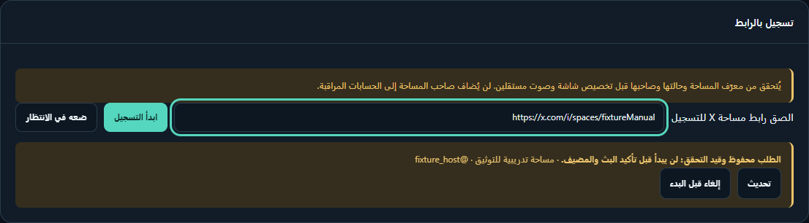
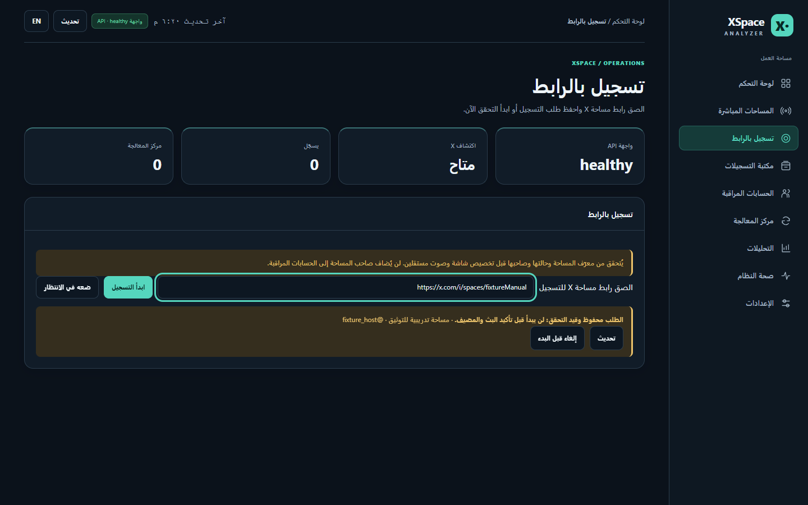
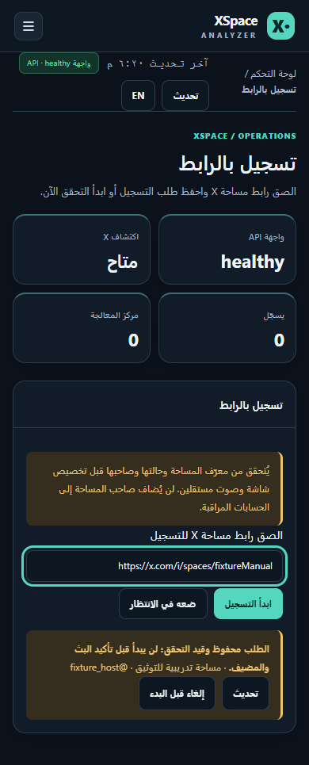
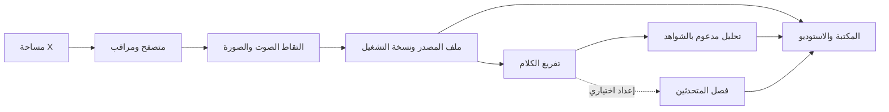

# مدار · MADAR

<p align="center"></p>

<p align="center"><strong>من البث المباشر إلى تسجيل يمكن البحث فيه وفهمه.</strong><br>منصة محلية لمساحات X: اكتشاف، تسجيل صوت وصورة، تفريغ، تحليل، ومراجعة داخل استوديو واحد.</p>

<p align="center"><a href="https://github.com/abooodHub/madar-space/actions/workflows/tests.yml"></a></p>

<p align="center"><a href="#نافذة-التسجيل-بالرابط">شاهد التسجيل</a> · <a href="#البداية-السريعة">ابدأ التشغيل</a> · <a href="#جولة-داخل-المنصة">استكشف الواجهة</a> · <a href="docs/FEATURES.md">كل الميزات</a></p>

> **الصور توضيحية من اختبار معزول.** لا يحتوي المستودع على حسابات مراقَبة أو تسجيلات فعلية أو جلسة X أو أسرار. تظهر هوية XSpace Analyzer في بعض لقطات الواجهة الحالية؛ «مدار» اسم المشروع المنشور.

## الفكرة في أربع خطوات

| 04 · راجع | 03 · عالج | 02 · سجّل | 01 · اكتشف |
| --- | --- | --- | --- |
| ابحث في المكتبة، وافتح المشغل والنص المرتبط بالتوقيت والشواهد. | جهّز ملف التشغيل، وفرّغ الكلام، وأنشئ التحليل عند توفر العامل. | تحقق من البث والمضيف، ثم التقط الصوت والصورة في جلسة مستقلة. | راقب الحسابات التي تضيفها أو أدخل رابط مساحة مباشرة. |

**الحالة واضحة في كل مرحلة:** يعرض النظام حالة الالتقاط، جودة الوسائط، التفريغ، والتحليل بصورة منفصلة، مع سبب الانتظار أو الفشل والإجراء التالي عند توفره.

## نافذة التسجيل بالرابط

لقطة مركزة من **نافذة التسجيل الفعلية** في المنصة. الرابط والمضيف وحالة الطلب في الصورة بيانات اختبار؛ الحالة الظاهرة **قيد التحقق** ولا تعني أن الالتقاط بدأ.



<details>
<summary><strong>شاهد الصفحة الكاملة على سطح المكتب والجوال</strong></summary>





</details>

### من الرابط إلى الملف

1. افتح **تسجيل بالرابط** والصق رابطًا مثل `https://x.com/i/spaces/SPACE_ID`.
2. اختر **ابدأ التسجيل** لطلب التحقق الآن، أو **ضعه في الانتظار** لحفظ الطلب. يتحقق النظام من المساحة ومضيفها قبل تخصيص الالتقاط.
3. راقب الطلب في النافذة نفسها. يمكن إلغاؤه قبل البدء، ويظهر خيار الإيقاف عند وجود تسجيل نشط.
4. بعد اكتمال الالتقاط، افتح **مكتبة التسجيلات** لمراجعة حالة الملف، ثم الاستوديو لتشغيله ومراجعة النص والتحليل إن اكتملت مهامهما.

| معناها | الحالة المعروضة |
| --- | --- |
| الطلب سُجّل؛ يجري التأكد من حالة البث والمضيف. | محفوظ وقيد التحقق |
| يجري إعداد الالتقاط. | تجهيز جلسة التسجيل |
| بدأت محاولة الالتقاط؛ راقب الحالة والملف الناتج. | بدأت محاولة التسجيل |
| انتهى الالتقاط ويمكن مراجعة الوسائط. | اكتمل التسجيل |
| راجع السبب الظاهر في الصفحة؛ لا تفترض وجود ملف مكتمل. | فشلت المحاولة أو المساحة منتهية |

إضافة رابط مساحة لا تضيف مضيفها تلقائيًا إلى الحسابات المراقَبة. قد تتأخر المعالجة أو تتوقف وفق حالة X والمتصفح والعامل؛ اعتمد على الحالة المعروضة لكل مرحلة.

## جولة داخل المنصة

### مكتبة التسجيلات

ابحث وفرز التسجيلات، ثم اعرف حالة الملف والصوت والتفريغ والتحليل قبل فتح أي مساحة.


<details>
<summary><strong>الاستوديو: المشغل والنص المرتبط بالوقت</strong></summary>

انتقل من جملة في التفريغ إلى موضعها في التسجيل، وراجع خط الزمن والملفات المتاحة.


</details>

<details>
<summary><strong>مركز المعالجة ولوحة التحليل</strong></summary>

تابع الطابور والعامل، ثم افتح النتائج التي يمكن ربطها بالمقطع المصدر.


</details>

<details>
<summary><strong>الحسابات المراقَبة ومشغل الجوال</strong></summary>

أضف الحسابات التي تختارها بنفسك، وتابع موعد الفحص والمساحات المكتشفة.


</details>

## البداية السريعة

**المتطلبات:** Windows وDocker Desktop ومساحة تخزين محلية للوسائط. يحتاج اكتشاف مساحات X وتسجيلها إلى تسجيل دخولك إلى X داخل المتصفح المرفق. يبدأ المستودع دون حسابات مراقَبة.

من جذر المشروع:

```powershell
Copy-Item .env.example .env
# عدّل XSA_DATA_DIR في .env إلى مسار موجود على جهازك خارج OneDrive.
docker compose up -d --build
```

بعد تشغيل الحاويات:

1. افتح [متصفح المشروع](http://localhost:6080/vnc.html?autoconnect=true&resize=scale) وسجّل الدخول إلى X بنفسك.
2. افتح [الواجهة](http://localhost:8765). أضف من [الحسابات المراقَبة](http://localhost:8765/workspace/accounts) المعرّفات التي تريد متابعة مساحاتها.
3. استخدم [نافذة التسجيل](http://localhost:8765/workspace/manual) لمساحة محددة، أو راقب المساحات المكتشفة تلقائيًا.
4. افتح [المكتبة](http://localhost:8765/workspace/library) لمراجعة الالتقاط والملف والتفريغ والتحليل.

وثائق API: <http://localhost:8765/docs> · فحص الصحة: <http://localhost:8765/health>

```powershell
docker compose down
```

ملف `.env` وجلسة المتصفح وقاعدة البيانات والتسجيلات **محلية وخارج Git**. لا تضع كلمة مرور X أو رموز الجلسة داخل المشروع. احترم حقوق المشاركين وشروط الخدمة والقوانين المطبقة عند التسجيل أو مشاركة النتائج.

## كيف تنتقل البيانات؟



تُحفظ الوسائط محليًا، بينما تُعرض حالات تجهيزها والتفريغ والتحليل بصورة مستقلة. فصل المتحدثين **اختياري** ويحتاج عاملًا منفصلًا وإعداد النموذج؛ وجود مهمة في الطابور لا يعني أن العامل بدأ تنفيذها.

## خريطة المشروع

| وظيفته | المسار |
| --- | --- |
| API، مراقبة المساحات، الالتقاط، مهام الوسائط، التفريغ والتحليل. | [`backend/xsa`](backend/xsa) |
| ملفات واجهة العمل والمشغل. | [`backend/xsa/api/assets`](backend/xsa/api/assets) |
| اختبارات السلوك والحدود الحرجة. | [`backend/tests`](backend/tests) |
| الخدمات المحلية والعوامل الاختيارية. | [`docker`](docker) و[`docker-compose.yml`](docker-compose.yml) |
| توثيق الميزات والخصوصية وصور العرض التجريبية. | [`docs`](docs) |

## التطوير والتحقق

```powershell
cd backend
uv run --extra dev pytest -q
uv run --extra dev ruff check .
uv run --extra dev ruff format --check xsa tests scripts
uv run --extra dev python scripts/verify_local_workspace.py ../artifacts/fixture-check
```

نتيجة التحقق عند تحديث هذا الدليل: **287 اختبارًا برمجيًا** و**23 حالة متصفح** ببيانات مؤقتة معزولة. سكربت لقطات التوثيق لا يشغّل متصفح X أو المراقب أو الالتقاط؛ حالة طلب التسجيل فيه محاكاة للواجهة فقط.

## حدود النسخة الحالية

- التحقق من هوية المتحدث يعتمد على الأدلة الصوتية المتاحة؛ ظهور حساب في المساحة لا يثبت هوية الصوت.
- فصل المتحدثين يحتاج عامل Docker منفصلًا وشروط وصول إلى النموذج. تبقى المهام محفوظة في الانتظار إلى أن يكتمل الإعداد.
- الواجهة الحالية ما زالت في مرحلة إعادة التصميم؛ الملفات فُصلت إلى HTML وCSS وJavaScript لتسهيل التطوير.
- التطبيق مهيأ للاستضافة المحلية. لا تنشر منفذي الواجهة والمتصفح على الإنترنت دون طبقة مصادقة وشبكة مناسبة.

تفاصيل البنية والخصوصية: [الميزات](docs/FEATURES.md) · [الخصوصية والبيانات](docs/PRIVACY.md).

