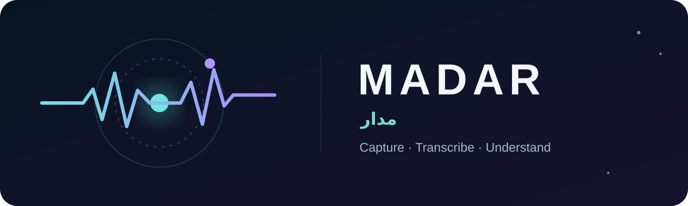
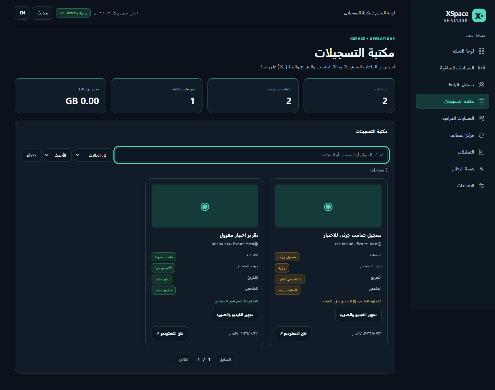
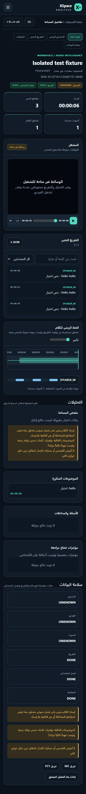
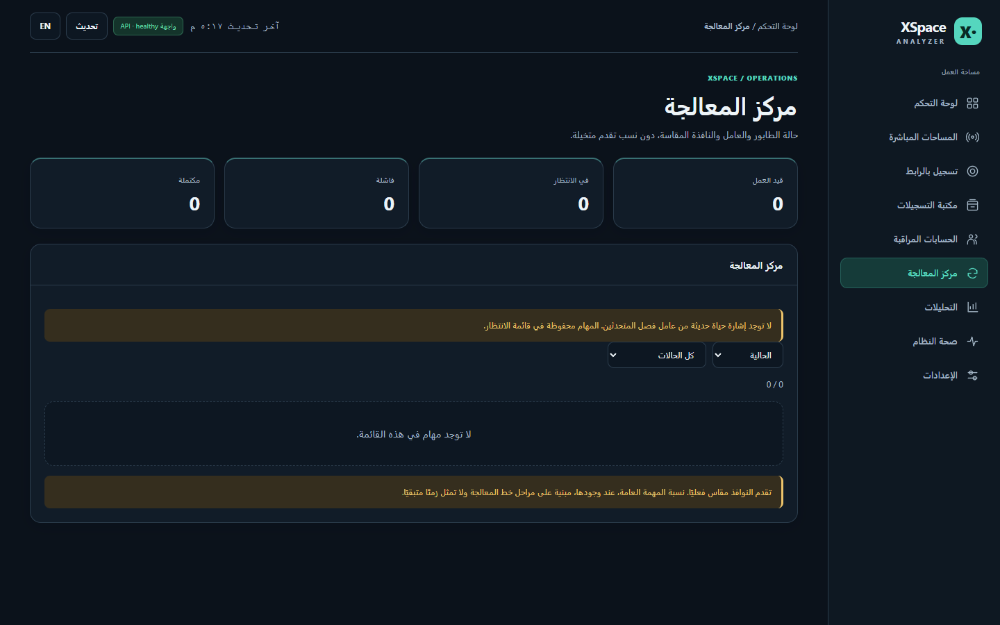
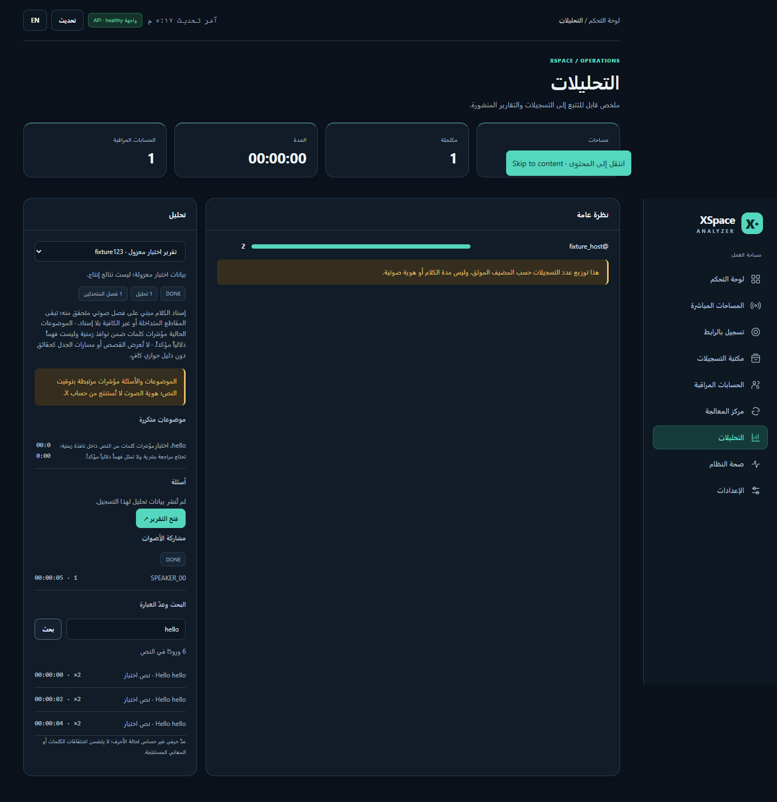
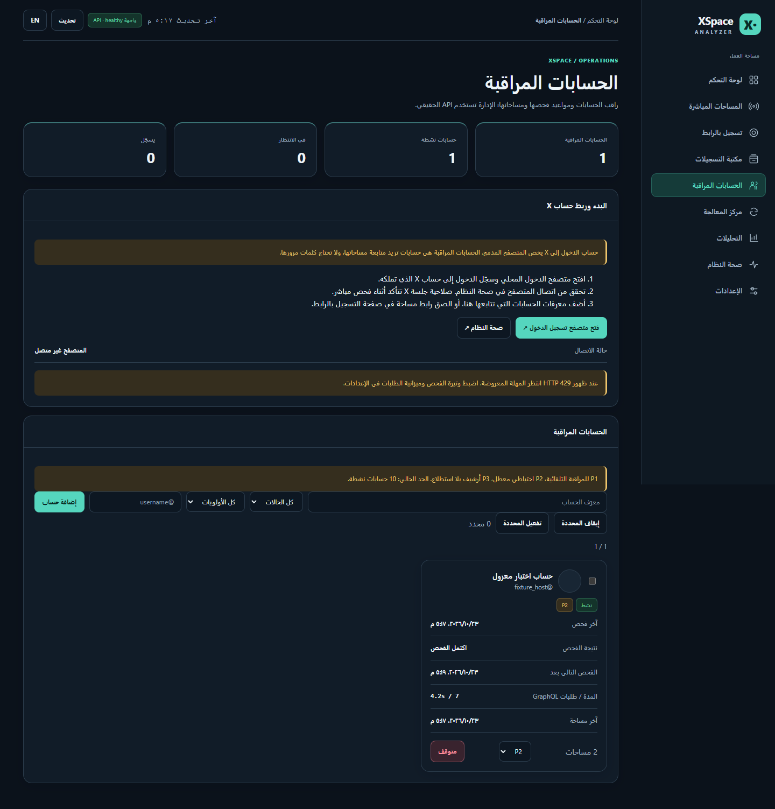
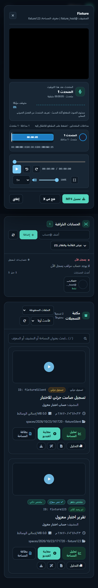
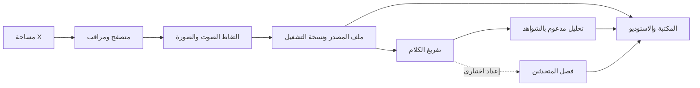

# مدار · MADAR

[](https://github.com/abooodHub/madar-space/actions/workflows/tests.yml)

**من لحظة البث إلى معرفة قابلة للبحث.** منصة محلية لمتابعة مساحات X، تسجيلها، تجهيز الفيديو، تفريغ الكلام وتحليل النتائج في واجهة عربية تدعم الإنجليزية.



> الصور أدناه صُنعت من **بيانات اختبار معزولة**. لا يحتوي هذا المستودع على تسجيلات أو حسابات مراقَبة أو جلسة X أو رموز وصول. تظهر عبارة XSpace Analyzer في بعض لقطات الواجهة الحالية؛ «مدار» هو الاسم المقترح للمشروع عند نشره.

## ماذا يقدم؟

| المجال | ما الذي يمكن فعله؟ |
| --- | --- |
| الاكتشاف والتسجيل | متابعة حسابات تختارها، اكتشاف المساحات، أو تسجيل مساحة عبر رابط مباشر. |
| التقاط الوسائط | تسجيل الصورة والصوت، إدارة المقاطع، والتحقق من اكتمال الملف قبل نشر نسخة التشغيل. |
| مكتبة التسجيلات | بحث وفرز وحالات منفصلة للالتقاط وجودة الملف والتفريغ والتحليل، مع الإجراء التالي لكل مساحة. |
| التفريغ والتحليل | نص بتوقيتاته، ملخص وموضوعات وأسئلة ومؤشرات مراجعة مرتبطة بالمقطع المصدر. |
| الاستوديو | مشغل وتفريغ متزامن وخط زمني للكلام وروابط تنزيل الملفات. |
| تشغيل موثوق | طابور معالجة محفوظ، استعادة بعد إعادة التشغيل، فحص صحة، نسخ احتياطي وبوابة صيانة للنشر. |

فصل المتحدثين الصوتي **اختياري** ويتطلب عاملًا منفصلًا وإعداد النموذج؛ وجود المهمة في الطابور لا يعني أن العامل يعمل. راجع [دليل الميزات والحدود](docs/FEATURES.md).

## جولة مصورة

<details open>
<summary><strong>المكتبة: تعرف حالة كل تسجيل قبل فتحه</strong></summary>



</details>

<details>
<summary><strong>الاستوديو: مشغل ونص وخط زمني على شاشة صغيرة</strong></summary>



</details>

<details>
<summary><strong>المعالجة والتحليل</strong></summary>





</details>

<details>
<summary><strong>الحسابات والمشغل</strong></summary>





</details>

## البداية السريعة

المسار المثبت للتشغيل هو **Windows مع Docker Desktop**. يحتاج التسجيل الفعلي إلى تسجيل دخولك إلى X داخل المتصفح المرفق، وإلى مساحة تخزين كافية للوسائط. لا يتضمن المستودع أي حسابات مراقَبة مسبقة.

```powershell
Copy-Item .env.example .env
# اضبط XSA_DATA_DIR في .env على مجلد محلي خارج OneDrive إذا رغبت.
docker compose up -d --build
```

بعد تشغيل الحاويات:

1. افتح [متصفح المشروع](http://localhost:6080/vnc.html?autoconnect=true&resize=scale) وسجّل الدخول إلى X بنفسك.
2. افتح [الواجهة](http://localhost:8765) ثم [الحسابات المراقَبة](http://localhost:8765/workspace/accounts) وأضف الحسابات التي تريد متابعتها.
3. استخدم [التسجيل بالرابط](http://localhost:8765/workspace/manual) لتسجيل مساحة محددة، أو انتظر الاكتشاف التلقائي.
4. افتح [المكتبة](http://localhost:8765/workspace/library) لمراجعة التسجيل وحالة الوسائط والتفريغ والتحليل.

وثائق API: <http://localhost:8765/docs> · فحص الصحة: <http://localhost:8765/health>

```powershell
docker compose down
```

ملف `.env` وجلسة المتصفح وقاعدة البيانات والتسجيلات **محلية وخارج Git**. لا تضع كلمة مرور X أو رموز الجلسة داخل المشروع. احترم حقوق المشاركين وشروط الخدمة والقوانين المطبقة عند التسجيل أو مشاركة النتائج.

## كيف تنتقل البيانات؟



## التطوير والتحقق

```powershell
cd backend
uv run --extra dev pytest -q
uv run --extra dev ruff check .
uv run --extra dev ruff format --check xsa tests scripts
uv run --extra dev python scripts/verify_local_workspace.py ../artifacts/fixture-check
```

اختبار المتصفح الأخير مرّ على 20 حالة ببيانات مؤقتة معزولة، والاختبارات البرمجية: **287 ناجحة**. لقطات التوثيق مأخوذة من هذا الاختبار، لا من قاعدة تشغيل حقيقية.

## حدود النسخة الحالية

- التحقق من هوية المتحدث يعتمد على الأدلة الصوتية المتاحة؛ ظهور حساب في المساحة لا يثبت هوية الصوت.
- فصل المتحدثين يحتاج عامل Docker منفصلًا وشروط وصول إلى النموذج. تبقى المهام محفوظة في الانتظار إلى أن يكتمل الإعداد.
- الواجهة الحالية ما زالت في مرحلة إعادة التصميم؛ الملفات فُصلت إلى HTML وCSS وJavaScript لتسهيل التطوير.
- التطبيق مهيأ للاستضافة المحلية. لا تنشر منفذي الواجهة والمتصفح على الإنترنت دون طبقة مصادقة وشبكة مناسبة.

تفاصيل البنية والخصوصية: [الميزات](docs/FEATURES.md) · [الخصوصية والبيانات](docs/PRIVACY.md).

